<div align="center">


# qui

**One clean web app for your whole download and media stack.**

Manage every qBittorrent instance, watch your VPN, keep your MyAnonamouse IP up to date, track Sonarr, Radarr and friends, sync what you watched between Jellyfin and Plex, and let an AI assistant build your playlists.

[](https://github.com/gjhuerte/qui/releases/latest)
[](https://github.com/gjhuerte/qui/pkgs/container/qui)
[](LICENSE)

[Quick start](#-quick-start) · [Tour](#-a-quick-tour) · [Full stack](#-full-stack-gluetun--qbittorrent--qui) · [Setup guides](#-setup-guides) · [Troubleshooting](#-troubleshooting) · [Docs](#-documentation)

</div>

<br />

<picture>
  <source media="(prefers-color-scheme: dark)" srcset="documentation/static/img/screenshots/dark/torrents.webp" />
  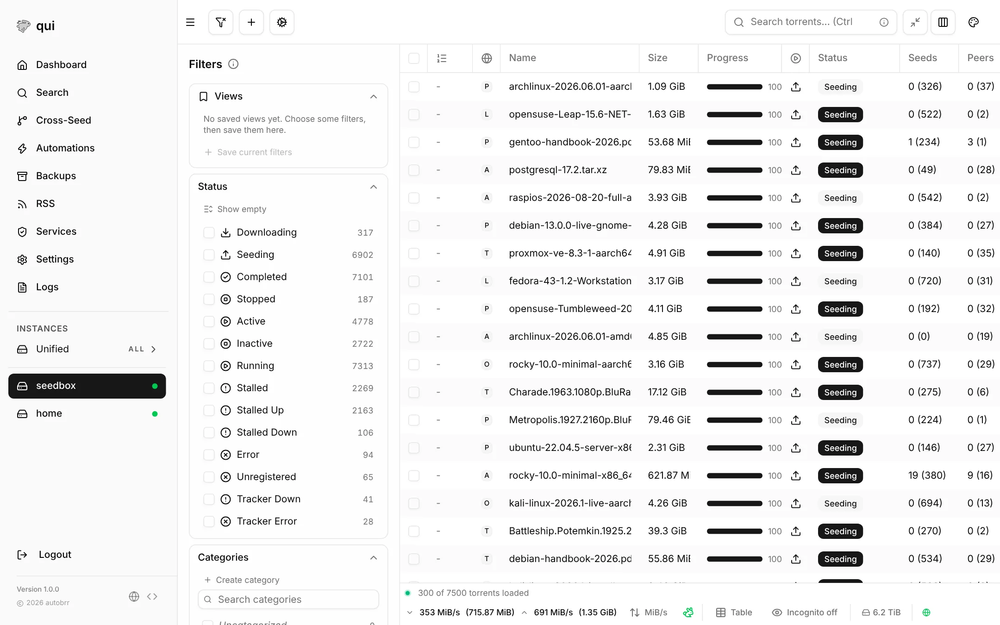
</picture>

<br />

## ✨ Why qui

- **Fast with big libraries.** Thousands of torrents stay smooth: live updates over one stream and a virtualized table.
- **Everything in one place.** Torrents, VPN, seedbox IP, *arr apps, media servers and playlists share one sign-in and one look.
- **One small binary.** The web UI is built in. SQLite out of the box, Postgres if you want it. Runs anywhere Docker or Linux runs.
- **Yours.** Self-hosted, no account, no telemetry. Credentials are stored encrypted.

> Screenshots use the built-in **Minimal** theme, in light or dark to match your GitHub theme. Pick another theme or your own under **Settings → Themes**.

<br />

## 🚀 Quick start

**1. Start qui**

```bash
docker run -d --name qui -p 7476:7476 -v "$(pwd)/config:/config" ghcr.io/gjhuerte/qui:latest
```

**2. Open it.** Go to **http://localhost:7476** and create your account.

**3. Connect qBittorrent.** Open **Settings → Instances → Add instance** and enter your qBittorrent WebUI address, user and password.

That's it. Your torrents appear right away.

<details>
<summary><b>Run without Docker (Linux x86_64)</b></summary>

```bash
wget $(curl -s https://api.github.com/repos/gjhuerte/qui/releases/latest | grep browser_download_url | grep linux_x86_64 | cut -d\" -f4)
sudo tar -C /usr/local/bin -xzf qui*.tar.gz qui
qui serve
```

</details>

Want torrents behind a VPN? Use the [full stack](#-full-stack-gluetun--qbittorrent--qui) with gluetun instead.

<br />

## 👀 A quick tour

### Torrents

Every qBittorrent instance in one list, or each on its own. Filter by status, category, tag and tracker, save views, and act on thousands of torrents at once.

<picture>
  <source media="(prefers-color-scheme: dark)" srcset="documentation/static/img/screenshots/dark/torrent-details.webp" />
  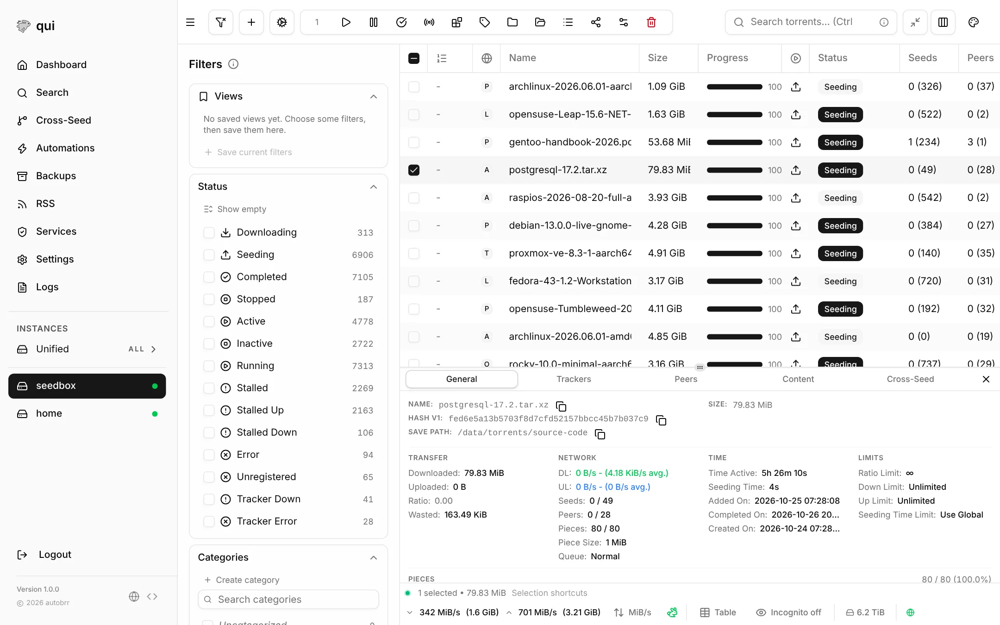
</picture>

- **Manage:** add, move, rename, recheck, edit trackers, set priorities and limits.
- **Details:** general info, trackers, peers, files and cross-seed matches for any torrent.
- **Search and RSS:** search your Torznab, Jackett and Prowlarr indexers, and manage qBittorrent feeds and download rules.
- **Privacy:** incognito mode (the eye in the status bar) swaps names, trackers and paths for fake ones before you share a screenshot.

### Dashboard

Speeds, ratios and problems across all instances at a glance: what is downloading, seeding or stuck, and which trackers have errors.

<picture>
  <source media="(prefers-color-scheme: dark)" srcset="documentation/static/img/screenshots/dark/dashboard.webp" />
  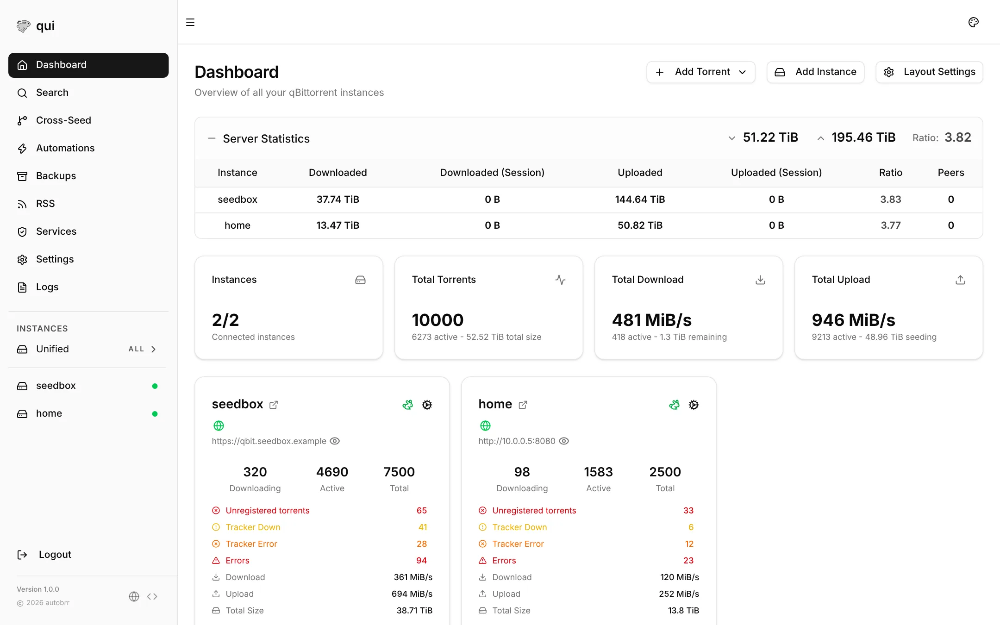
</picture>

### Automation

| | |
| --- | --- |
| **Cross-seed** | Find and add matching torrents across trackers, from RSS, webhooks, finished downloads, your library or a folder scan. |
| **Automations** | Rules that set speed limits, tags and categories, or move and delete torrents when conditions match. |
| **Reannounce** | Re-announces stalled torrents for you. |
| **Orphan scan** | Finds files on disk that no torrent uses, so you can clean them up. |
| **External programs** | Run your own scripts from the torrent list or from automations. |
| **Notifications** | Discord, Telegram, email and more. |
| **Backups** | Scheduled snapshots of each instance, with several restore modes. |

### Media apps: Sonarr, Radarr, Prowlarr, Bazarr, Tautulli

All your *arr apps on one screen: whether they are up, what they are downloading, what is missing, what comes out this week, disk space, failing indexers and who is watching on Plex. qui only reads from them; it never changes anything.

<table>
  <tr>
    <td width="50%">
      <picture>
        <source media="(prefers-color-scheme: dark)" srcset="documentation/static/img/screenshots/dark/media-apps.webp" />
        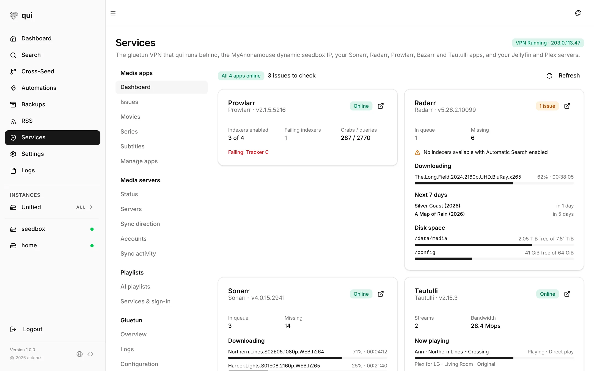
      </picture>
    </td>
    <td width="50%">
      <picture>
        <source media="(prefers-color-scheme: dark)" srcset="documentation/static/img/screenshots/dark/movies.webp" />
        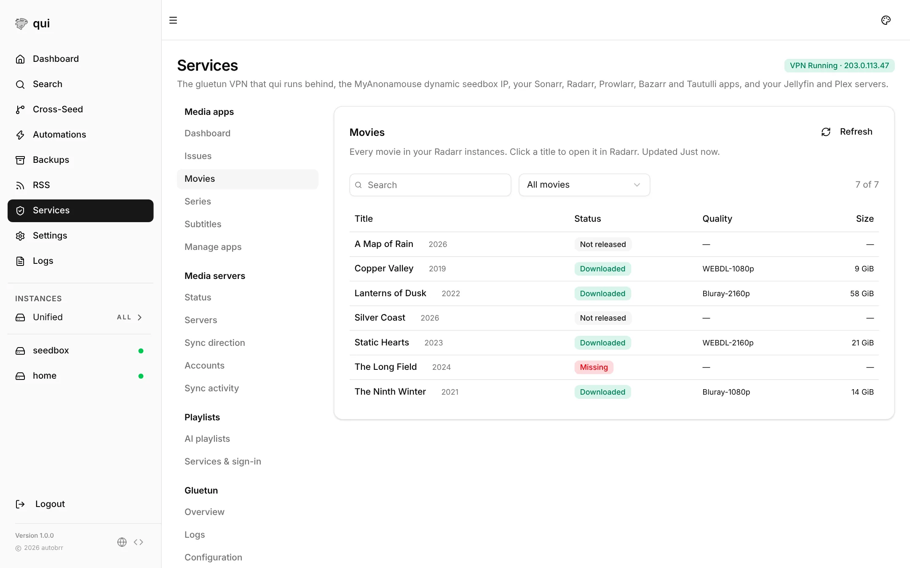
      </picture>
    </td>
  </tr>
  <tr>
    <td><b>Dashboard</b>: health, queue, missing items, the next 7 days and streams.</td>
    <td><b>Movies, Series, Subtitles</b>: every library in one searchable list, plus one list of <b>Issues</b>.</td>
  </tr>
</table>

### VPN and seedbox

When qui runs behind [gluetun](https://github.com/qdm12/gluetun), it shows the VPN status, public IP, location and forwarded port, and can restart the VPN or the container. It also keeps your MyAnonamouse dynamic seedbox IP up to date, so you no longer need the `seedboxapi` container.

<table>
  <tr>
    <td width="50%">
      <picture>
        <source media="(prefers-color-scheme: dark)" srcset="documentation/static/img/screenshots/dark/gluetun.webp" />
        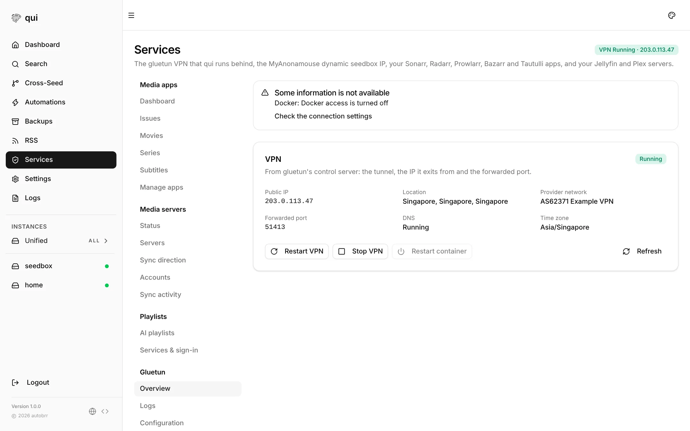
      </picture>
    </td>
    <td width="50%">
      <picture>
        <source media="(prefers-color-scheme: dark)" srcset="documentation/static/img/screenshots/dark/seedbox.webp" />
        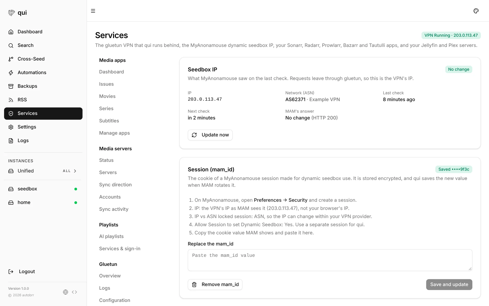
      </picture>
    </td>
  </tr>
  <tr>
    <td><b>Gluetun</b>: status, logs, configuration, one-click restarts.</td>
    <td><b>Seedbox (MAM)</b>: automatic IP updates with a 14-day history.</td>
  </tr>
</table>

### Media servers: Jellyfin and Plex

See each server's libraries and who is watching what right now. Then let qui keep watched state in sync: watch an episode on Plex, and it is marked watched on Jellyfin too, for every person you map.

<table>
  <tr>
    <td width="50%">
      <picture>
        <source media="(prefers-color-scheme: dark)" srcset="documentation/static/img/screenshots/dark/media-servers.webp" />
        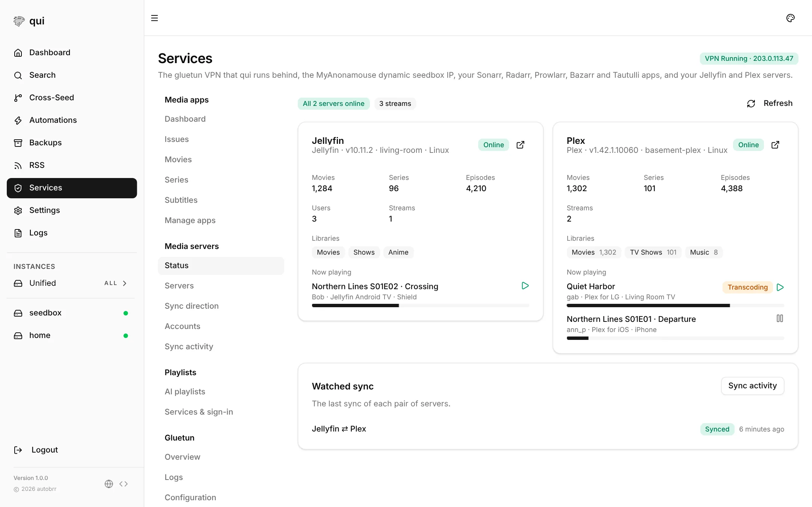
      </picture>
    </td>
    <td width="50%">
      <picture>
        <source media="(prefers-color-scheme: dark)" srcset="documentation/static/img/screenshots/dark/watched-sync.webp" />
        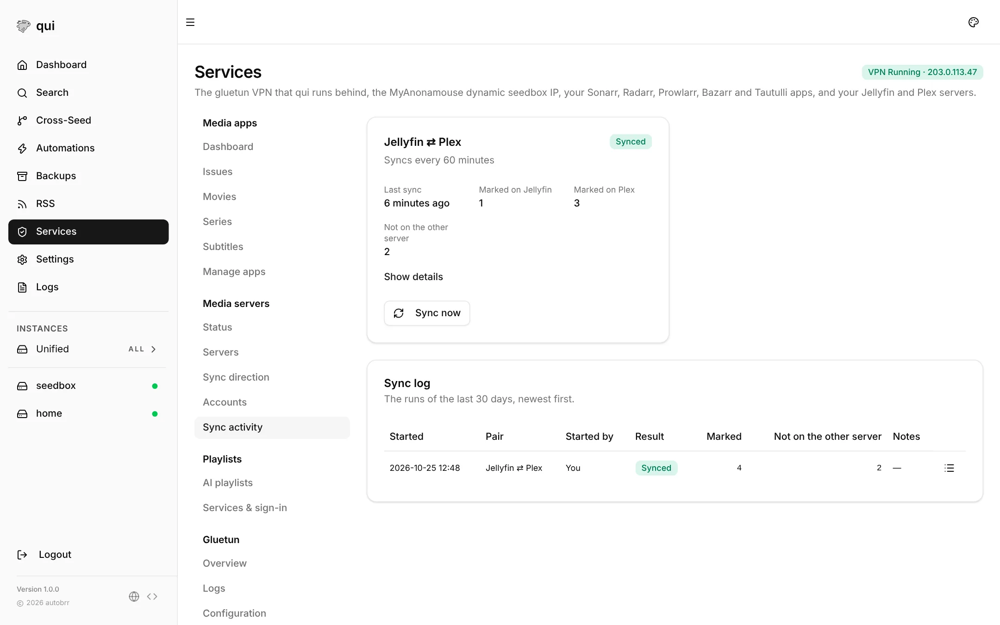
      </picture>
    </td>
  </tr>
  <tr>
    <td><b>Status</b>: versions, libraries, streams and transcodes.</td>
    <td><b>Watched sync</b>: both ways or one way, on a schedule or with <b>Sync now</b>, with a log of every title marked.</td>
  </tr>
</table>

### AI playlists

Describe a mood, get a playlist. qui exports your music library and writes the prompt; you paste it into ChatGPT, Claude or Gemini, paste the answer back, and send the playlist to Jellyfin, Plex, Spotify or YouTube Music. Already have a playlist there? Compare both side by side and choose what each keeps.

<table>
  <tr>
    <td width="50%">
      <picture>
        <source media="(prefers-color-scheme: dark)" srcset="documentation/static/img/screenshots/dark/ai-playlists.webp" />
        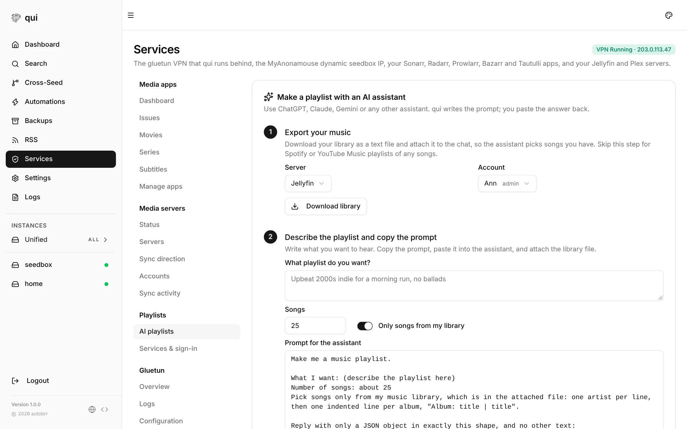
      </picture>
    </td>
    <td width="50%">
      <picture>
        <source media="(prefers-color-scheme: dark)" srcset="documentation/static/img/screenshots/dark/playlist-compare.webp" />
        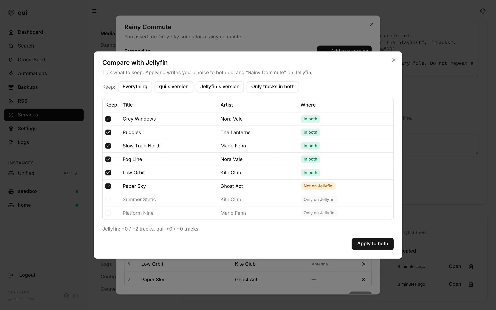
      </picture>
    </td>
  </tr>
  <tr>
    <td><b>Make</b>: export, prompt, paste. Three steps.</td>
    <td><b>Compare</b>: in both, only in qui, only on the service. Tick what stays.</td>
  </tr>
</table>

### And also

- **qBittorrent proxy:** give Sonarr, Radarr, autobrr and other apps a qBittorrent-compatible endpoint with their own API keys.
- **Sign-in:** a built-in account or OpenID Connect.
- **Themes:** built-in themes, light and dark, or your own.
- **Languages:** English, German, French, Italian, Czech, Ukrainian, Korean, Brazilian Portuguese, Simplified and Traditional Chinese, and Catalan.
- **Install as an app:** qui is a PWA, so you can add it to your phone's home screen.

<br />

## 🧱 Full stack: gluetun + qBittorrent + qui

This stack sends all torrent traffic through the VPN. qBittorrent and qui share gluetun's network (`network_mode: "service:gluetun"`), so their ports are published on the **gluetun** service, and qui reaches qBittorrent and gluetun at `127.0.0.1`.

### 1. Prepare the folder

```bash
mkdir -p gluetun qbittorrent qui-config docker-proxy downloads
id -u                                  # your user id (1000 below)
getent group docker | cut -d: -f3      # docker group id (999 below)
docker run --rm qmcgaw/gluetun genkey  # API key for gluetun's control server
```

### 2. `docker-compose.yml`

```yaml
services:
  gluetun:
    image: qmcgaw/gluetun
    container_name: gluetun
    cap_add:
      - NET_ADMIN
    devices:
      - /dev/net/tun:/dev/net/tun
    volumes:
      - ./gluetun:/gluetun
    environment:
      - VPN_SERVICE_PROVIDER=protonvpn
      - VPN_TYPE=wireguard
      - WIREGUARD_PRIVATE_KEY=your-wireguard-private-key
      - SERVER_COUNTRIES=Singapore
      - FIREWALL=on
      - VPN_PORT_FORWARDING=on
      # Send the forwarded port to qBittorrent whenever it changes
      - VPN_PORT_FORWARDING_UP_COMMAND=/bin/sh -c 'wget -O- --retry-connrefused --post-data "json={\"listen_port\":{{PORTS}}}" http://127.0.0.1:8080/api/v2/app/setPreferences 2>&1'
      # Lets qui use the control server. No quotes around the JSON.
      - HTTP_CONTROL_SERVER_AUTH_DEFAULT_ROLE={"auth":"apikey","apikey":"your-gluetun-api-key"}
      - HEALTH_TARGET_ADDRESS=1.1.1.1
      # Lets qui reach apps on your LAN and Docker networks (Media apps)
      - FIREWALL_OUTBOUND_SUBNETS=192.168.1.0/24,172.16.0.0/12
    ports:
      - "7476:7476" # qui
      - "8080:8080" # qBittorrent WebUI
    healthcheck:
      test: ["CMD", "ping", "-c", "1", "1.1.1.1"]
      interval: 30s
      timeout: 10s
      retries: 3
    restart: always

  qbittorrent:
    image: lscr.io/linuxserver/qbittorrent
    container_name: qbittorrent
    network_mode: "service:gluetun"
    environment:
      - PUID=1000
      - PGID=1000
      - WEBUI_PORT=8080
    volumes:
      - ./qbittorrent:/config
      - ./downloads:/downloads
    depends_on:
      - gluetun
    restart: unless-stopped

  # Gives qui only the Docker calls it needs (read status and logs, restart).
  # Optional: without it, qui still shows the VPN status, IP and port.
  socket-proxy:
    image: wollomatic/socket-proxy:1.13.1
    container_name: socket-proxy
    user: "1000:999"            # your user id : docker group id
    network_mode: none
    read_only: true
    cap_drop: [ALL]
    security_opt: [no-new-privileges:true]
    mem_limit: 64m
    command:
      - '-proxysocketendpoint=/socket/docker.sock'
      - '-proxysocketendpointfilemode=0600'
      - '-allowGET=/(v[0-9.]+/)?(_ping|containers/json|containers/[a-zA-Z0-9_.-]+/(json|logs|stats)|images/[a-zA-Z0-9_.:@/-]+/json)'
      - '-allowPOST=/(v[0-9.]+/)?containers/[a-zA-Z0-9_.-]+/restart'
    volumes:
      - /var/run/docker.sock:/var/run/docker.sock:ro
      - ./docker-proxy:/socket
    restart: unless-stopped

  qui:
    image: ghcr.io/gjhuerte/qui:latest
    container_name: qui
    network_mode: "service:gluetun"
    user: "1000:1000"
    volumes:
      - ./qui-config:/config
      - ./downloads:/downloads     # same path as in qBittorrent
      - ./docker-proxy:/var/run/docker-proxy
    depends_on:
      - gluetun
    restart: unless-stopped
```

```bash
docker compose up -d
```

### 3. Connect qui to qBittorrent

1. Open **http://localhost:7476** and create your account.
2. Go to **Settings → Instances → Add instance**. Use `http://127.0.0.1:8080` as the host, with your qBittorrent WebUI user and password. The linuxserver image prints a temporary password in `docker logs qbittorrent` on the first start.
3. In qBittorrent, open **Options → WebUI** and turn on **Bypass authentication for clients on localhost**. The port-forwarding command in gluetun needs it to update the listening port.

<br />

## 🛠 Setup guides

Everything below lives under **Services** in the sidebar.

### Gluetun

Open **Services → Gluetun → Connection**:

| Setting | Value |
| --- | --- |
| Control server URL | `http://127.0.0.1:8000` |
| Authentication | API key: the key from `HTTP_CONTROL_SERVER_AUTH_DEFAULT_ROLE` |
| Use the Docker API | On, if you added the socket proxy |
| Docker host | `unix:///var/run/docker-proxy/docker.sock` |
| Gluetun container name | `gluetun` |

Click **Save**, then open **Overview**. It should show the VPN as **Running** with your public IP, location and forwarded port.

| Button | What it does |
| --- | --- |
| **Restart VPN** | Stops and starts the tunnel; containers keep their network. Try this first when the VPN is stuck. |
| **Start / Stop VPN** | Turns the tunnel on or off. |
| **Restart container** | Restarts gluetun through Docker, waits until it is healthy, then restarts the containers that share its network (qBittorrent and qui). qui reloads by itself. |

**Logs** shows the gluetun log with level filter and search; **Configuration** shows its settings with keys and passwords hidden.

### MyAnonamouse seedbox IP

qui calls MAM's dynamic seedbox endpoint on a schedule. Because qui runs inside gluetun, MAM registers your **VPN** IP.

1. Open **Services → Seedbox (MAM) → Dynamic IP** and click **Update now**. Before you add a cookie, this only shows the IP and network MAM sees.
2. On MyAnonamouse, go to **Preferences → Security** and create a session:
   - **IP:** the IP from step 1, not your browser's IP.
   - **IP vs ASN locked session:** **ASN**, so the IP can change within your VPN provider.
   - **Allow Session to set Dynamic Seedbox:** **Yes**.
   - **Label:** for example `qui`. Use a separate session for qui.
3. Copy the cookie value MAM shows, paste it into **Session (mam_id)**, and click **Save and update**. The result should be **Updated** or **No change**.
4. Under **Schedule**, keep automatic updates on. Every 10 minutes is fine: MAM answers *No change* when the IP is the same.

qui stores the cookie encrypted and saves the new one whenever MAM rotates it. If you used the `seedboxapi` container before, remove it and its port from gluetun, and create a new MAM session for qui.

### Media apps

1. Open **Services → Media apps → Manage apps** and click **Add app**.
2. Choose the app, give it a name (for example `Sonarr 4K`), and enter its URL and API key:

   | App | Default URL | Where to find the API key |
   | --- | --- | --- |
   | Sonarr | `http://<ip>:8989` | Settings → General → Security |
   | Radarr | `http://<ip>:7878` | Settings → General → Security |
   | Prowlarr | `http://<ip>:9696` | Settings → General → Security |
   | Bazarr | `http://<ip>:6767` | Settings → General → Security |
   | Tautulli | `http://<ip>:8181` | Settings → Web Interface → API (turn on **Enable API**) |

3. Click **Test**. It should say **Connected** with the app's version. Then click **Save**, and repeat for every instance.

The dashboard and issues refresh every minute and the libraries every five minutes; **Refresh** fetches new data right away. The **Enabled** switch hides an instance without deleting it.

<details>
<summary><b>Which URL to use when qui runs inside gluetun</b></summary>

<br />

| Where the app runs | URL in qui | Also needed |
| --- | --- | --- |
| Inside gluetun (`network_mode: "service:gluetun"`) | `http://127.0.0.1:<port>` | Nothing |
| On the same host, outside gluetun | `http://<host LAN IP>:<port>`, for example `http://192.168.1.10:8989` | The port published on the app, and your LAN in `FIREWALL_OUTBOUND_SUBNETS` |
| On another Docker network | `http://<container IP>:<port>` or the host IP and published port | That Docker network (for example `172.16.0.0/12`) in `FIREWALL_OUTBOUND_SUBNETS` |
| On another machine | `http://<machine IP>:<port>` | Your LAN in `FIREWALL_OUTBOUND_SUBNETS` |

qui's requests to apps outside gluetun pass gluetun's firewall; `FIREWALL_OUTBOUND_SUBNETS` lets them through without leaving the VPN for anything else. Container names do not work, because gluetun's DNS cannot resolve them. If an app runs under a URL base (for example `/sonarr`), include it: `http://192.168.1.10:8989/sonarr`.

The Sonarr and Radarr connections under **Settings → Integrations** are separate: cross-seed uses those to look up IDs.

</details>

### Watched sync between Jellyfin and Plex

1. **Servers:** open **Services → Media servers → Servers** and add each server, with a Jellyfin API key (**Dashboard → API Keys**) or the Plex owner's `X-Plex-Token`.
2. **Sync direction:** pick the two servers and choose **Both ways** or one way, and how often to sync.
3. **Accounts:** map each account to the same person's account on the other server, or click **Match by name**.
4. **Sync activity:** click **Sync now**. The log lists every title each sync marked.

qui only marks titles watched, never unwatched. Titles match on IMDb, TMDB and TVDB IDs. [More details](documentation/docs/features/services.md#media-servers).

### AI playlists

1. **Connect services** under **Services → Playlists → Services & sign-in**. Jellyfin and Plex use your media servers; Spotify and YouTube Music have step-by-step instructions there.
2. **Export and prompt:** on **AI playlists**, click **Download library**, describe the playlist, and click **Copy prompt**. Send both to your AI assistant.
3. **Paste** the answer and click **Create playlist**.
4. **Sync:** open the playlist and click **Add to a service**: create a new playlist there, or link one you already have and compare.

<details>
<summary><b>Spotify and YouTube Music notes</b></summary>

<br />

- **Spotify** needs your own free app from the [Spotify developer dashboard](https://developer.spotify.com/dashboard), and the account that creates it needs Premium. Set the redirect URI to qui's own HTTPS address (qui then finishes the sign-in by itself), or keep the default `http://127.0.0.1:8888/callback` and paste the address back, which works wherever qui runs.
- **YouTube Music** has no public API, so qui signs in with your browser's cookie (copy the request headers from the browser's developer tools). It can stop working when Google changes the site.

[More details](documentation/docs/features/services.md#playlists).

</details>

<br />

## 🩺 Troubleshooting

<details>
<summary><b>qui does not open</b></summary>

<br />

- Check that the container runs and read its log: `docker ps`, `docker logs qui`.
- With `network_mode: "service:gluetun"`, publish port **7476 on gluetun**, not on qui. If gluetun is unhealthy or restarting, qui is unreachable too.
- Behind a reverse proxy with `QUI__ALLOWED_HOSTS` set, add your hostname to it. Over HTTPS, set `QUI__SESSION_COOKIE_SECURE=true`.

</details>

<details>
<summary><b>I forgot my password</b></summary>

<br />

```bash
docker exec -it qui qui change-password --username <your-user>
```

</details>

<details>
<summary><b>qui cannot connect to qBittorrent</b></summary>

<br />

- Inside gluetun's network, the host is `http://127.0.0.1:8080`, not the container name.
- Check the WebUI user and password in qBittorrent. Too many failed logins ban the IP for a while; restart qBittorrent to clear the ban.
- After gluetun restarts, containers that share its network lose their network. Restart them: `docker compose up -d --force-recreate qbittorrent qui`, or use **Restart container** in qui, which does this for you.

</details>

<details>
<summary><b>Gluetun: "Unreachable" or "HTTP 401, check the control server authentication"</b></summary>

<br />

The control server rejects qui's request.

1. Test the key from the host (publish `8000` on gluetun, for example `"8003:8000"`):
   ```bash
   curl -i -H "X-API-Key: your-gluetun-api-key" http://localhost:8003/v1/vpn/status
   ```
2. **401 there too:** gluetun does not have the key. Check that `HTTP_CONTROL_SERVER_AUTH_DEFAULT_ROLE` is on the **gluetun** service, without quotes around the JSON, then recreate gluetun (`docker compose up -d gluetun`) and the containers that share its network.
3. **200 there:** qui has the wrong setting. In **Connection**, set **Authentication** to **API key**, paste the key again, and save.

Gluetun v3.40 and later refuse every control-server request until you set up authentication.

</details>

<details>
<summary><b>Gluetun: "Docker access is turned off" or no logs, health or stats</b></summary>

<br />

Logs, health, resource use and container restart need the Docker API. The VPN status, IP and port work without it.

| Message | Fix |
| --- | --- |
| `no such file or directory` | The socket is not mounted. Check the `./docker-proxy:/var/run/docker-proxy` volume on qui and the Docker host in **Connection**. |
| `permission denied` | qui's user cannot use the socket. The socket file must be owned by the same user id that qui runs as (`user:` on both services). |
| `no container named "gluetun"` | Set **Gluetun container name** to the `container_name` of your gluetun service. |
| `403` or `forbidden` from the proxy | The proxy blocked a call. Copy the `-allowGET` and `-allowPOST` lines exactly. |

The socket proxy itself logs `bind: permission denied` when it cannot create its socket. Give the folder to your user and start it again:

```bash
sudo chown "$(id -u):$(id -g)" docker-proxy
docker compose up -d socket-proxy
```

Do not mount `/var/run/docker.sock` into qui directly unless you accept the risk: anything that can use the raw socket controls the host.

</details>

<details>
<summary><b>Gluetun: no forwarded port</b></summary>

<br />

- Your provider must support port forwarding (Proton: a Plus plan and a P2P server), and `VPN_PORT_FORWARDING=on` must be set.
- Check **Logs** for `port forwarded is …`. If qBittorrent does not pick it up, turn on **Bypass authentication for clients on localhost** in qBittorrent.

</details>

<details>
<summary><b>Seedbox (MAM): what each result means</b></summary>

<br />

| Result | What to do |
| --- | --- |
| **No mam_id** | Paste a cookie in **Session (mam_id)**. |
| **Updated** / **No change** | Working. |
| **Too recent** | MAM limits how often the IP can change. Nothing to do; the next check retries. |
| **Rejected** (for example *ASN mismatch* or *IP mismatch*) | The session does not allow updates from this connection. Create a new session locked to **ASN**, with dynamic seedbox allowed, and paste the new cookie. |
| **Unreachable** | Usually the VPN is down. Check **Gluetun → Overview** and the gluetun log. |

</details>

<details>
<summary><b>Media apps: an app shows Offline</b></summary>

<br />

The red text on the card says why:

| Message | Fix |
| --- | --- |
| `i/o timeout` or `connection refused` | qui cannot reach the address. For an app outside gluetun, add its network to `FIREWALL_OUTBOUND_SUBNETS` on gluetun and recreate gluetun, qBittorrent and qui. Check the IP and port. |
| `no such host` | Use an IP address instead of a container or host name. |
| `HTTP 401: check the API key` | Copy the API key again from the app's settings. For Tautulli, also turn on **Enable API**. |
| `not found: check the URL` | The app runs under a URL base. Add it to the URL, for example `/sonarr`. |
| `did not answer with JSON` | The URL points at something else, often a reverse proxy login page. Use the app's direct address. |

To test from inside qui's network, run `docker exec qui wget -qO- http://192.168.1.10:8989/ping`. A timeout there means the gluetun firewall or the network blocks it, not qui.

**Some instances could not be loaded** on **Movies**, **Series** or **Subtitles** means one instance failed; the others still show. **Some details could not be loaded** on a card usually means an older app version; the other numbers are still correct.

</details>

<details>
<summary><b>Spotify: the redirect URI is refused</b></summary>

<br />

Spotify only accepts `https://` redirect URIs, or `http://127.0.0.1`. If you reach qui over plain `http://` on your LAN, keep the default `http://127.0.0.1:8888/callback`: after the sign-in the browser shows an error page, and you paste its address into qui. Whichever you use, the address in qui and in the Spotify dashboard must match exactly.

</details>

<details>
<summary><b>Collect information for a bug report</b></summary>

<br />

- qui version: shown at the bottom of the sidebar, or `docker exec qui qui version`.
- qui log: **Logs** in the sidebar, or `docker logs qui`.
- Gluetun log: **Services → Gluetun → Logs**, or `docker logs gluetun`.
- Turn on incognito mode (the eye icon in the torrent list status bar) before you take screenshots, so torrent names and trackers stay private.

</details>

<br />

## 📚 Documentation

Detailed guides live in [`documentation/docs`](documentation/docs):

| Topic | Guides |
| --- | --- |
| Install | [Docker](documentation/docs/getting-started/docker.md) · [Installation](documentation/docs/getting-started/installation.md) |
| Configure | [Environment variables](documentation/docs/configuration/environment.md) · [CLI commands](documentation/docs/configuration/cli-commands.md) |
| Features | [Services: gluetun, seedbox, media apps, media servers, playlists](documentation/docs/features/services.md) · [Cross-seed](documentation/docs/features/cross-seed) · [Automations](documentation/docs/features/automations.md) · [Backups](documentation/docs/features/backups.md) |

## 💬 Support

- [GitHub Discussions](https://github.com/gjhuerte/qui/discussions/new/choose): questions, feature requests and bug reports
- [GitHub Issues](https://github.com/gjhuerte/qui/issues): confirmed bugs and planned work

## 🤝 Contributing

[`CONTRIBUTING.md`](.github/CONTRIBUTING.md) explains who can contribute and how, and the development and test workflow.

## 📄 License

GPL-2.0-or-later. See [`LICENSE`](LICENSE) and [`LICENSE-GPL-2.0`](LICENSE-GPL-2.0).
